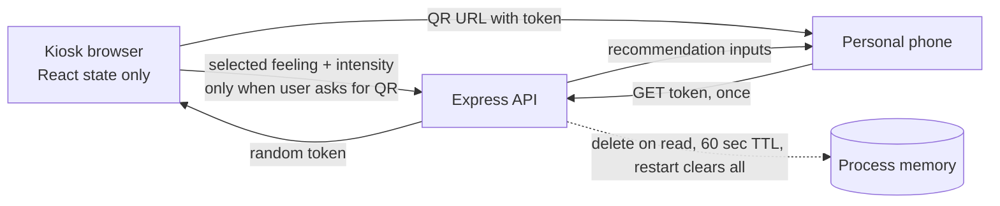

# Architecture and data flow

The kiosk never sends ordinary check-in answers to the API. Handoff creation is the only request containing the selected feeling and intensity. The API stores those two enum values with an unpredictable token and expiry in a bounded in-memory map. A successful read deletes the entry before returning its values; explicit close/clear sends a delete request. Expired records are pruned every 15 seconds and before create/read operations. No database or disk-backed session store is configured.

The mobile page receives the values once and renders the same local recommendation catalog as the kiosk. It does not receive a user or device identifier. The browser address temporarily contains a bearer token, so anyone who gets the unconsumed QR can claim it first. The token does not identify the person who created it.

## Deployment boundaries

- Run one server process unless a shared ephemeral store is deliberately designed and reviewed. In-memory tokens do not cross replicas.
- Put the service behind HTTPS. Configure the reverse proxy and kiosk operating system to avoid access logs that retain QR query strings, screenshots, browser history, or telemetry.
- Keep the kiosk browser in a restricted kiosk profile. Provide a physical privacy filter and clear browser state when the kiosk restarts.
- The checked-in client defaults target Rama University, Mandhana campus, Kanpur. Reconfirm the user-supplied campus phones and staffing before physical deployment; phone/link settings can be overridden through `.env`.
- The recommendation catalog and screen copy are examples, not clinical guidance. Have campus wellbeing staff review the language before deployment.
